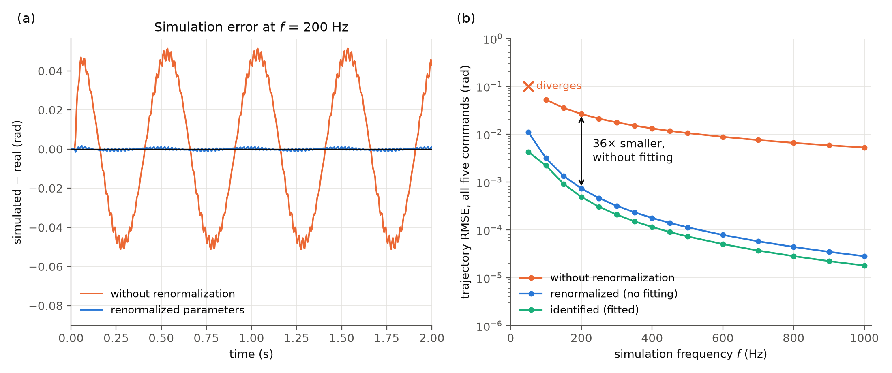
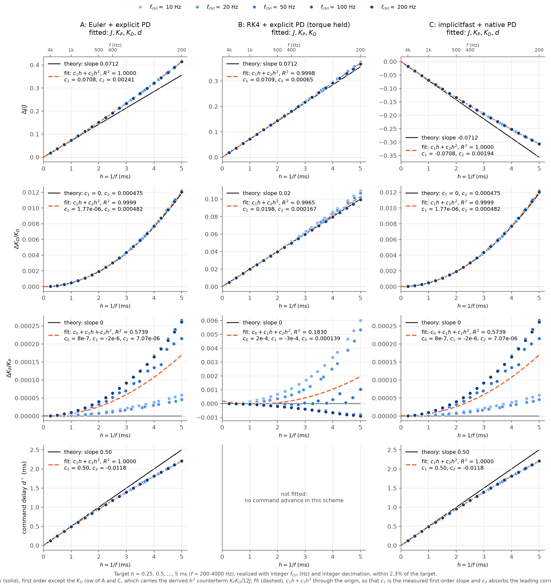
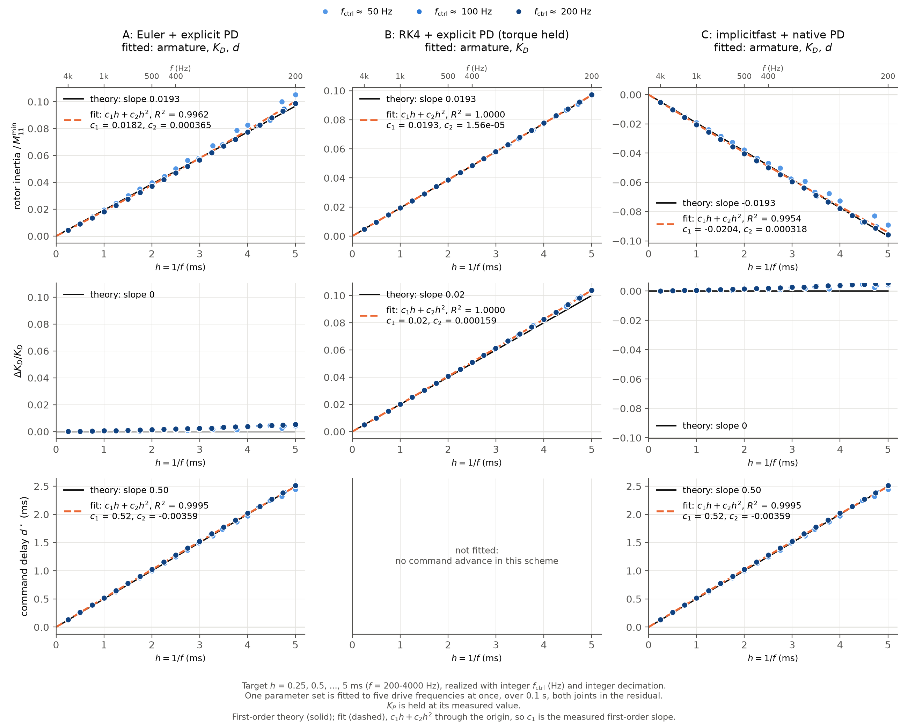
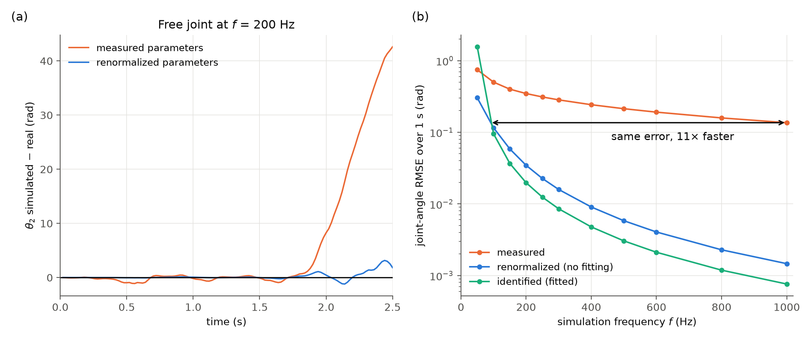
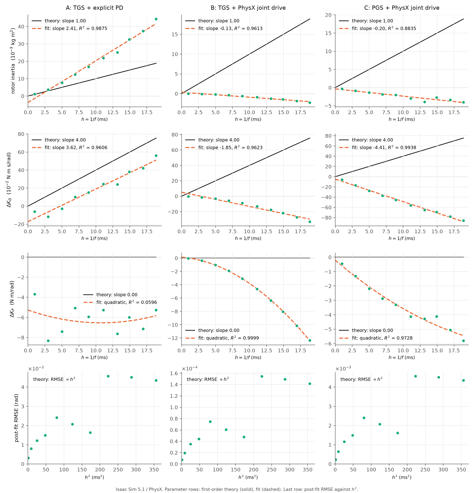

# Renormalization Robotics: Experiments

Experiments for *Effective Parameters, Real Behavior: Renormalization for Robotics — From Infinite Electron Mass to Sim-to-Real Gap* ([arXiv:2607.24079](https://arxiv.org/abs/2607.24079)).

The paper argues that simulator parameters should be treated as effective, resolution-dependent quantities $\theta^\star_{\mathrm{sim}}(a)$ rather than copies of measured values.
Its analytic example is PD control at a finite simulation frequency, where a small effective delay $\delta t \propto 1/f$ shifts the parameters that make the simulator reproduce the real motion:

$$
K_D^{\mathrm{sim}} = K_D^{\mathrm{real}} + \delta t\,K_P^{\mathrm{real}},
\qquad
J^{\mathrm{sim}} = J^{\mathrm{measured}} + \delta t\,K_D^{\mathrm{real}}.
$$

## Experiment 1: PD-controlled pendulum at finite simulation frequency



**(a) The measured parameters are the wrong ones to use.** At the legged_gym default of 200 Hz physics, a simulator given the rod's measured inertia and the robot's actual gains swings up to 0.05 rad away from the real pendulum on the 2 Hz command. The paper's first-order prediction, which needs no real-world data at all, stays on it. Pooled over all five commands the RMSE goes from 2.64e−2 rad to 7.30e−4 rad, with one parameter set used for every command.

**(b) The same holds across simulation frequencies, and the measured parameters eventually fail outright.**

- The renormalized parameters give a **36× smaller** error at 200 Hz, with no fitting. Measured parameters only match it at $f$ = 7.2 kHz, so the same accuracy costs 36× fewer physics steps.
- Fitting on top of the formula gains only another 1.50×, and the fitted parameters differ from the predicted ones by about 1% ($J^\star/J$ = 1.369 against 1.356 at 200 Hz). That residual is the second-order term in $h$, not an artifact of fitting: identifying on one command or on all five gives the same parameters to four digits.
- At 50 Hz the measured parameters diverge, while $J^\star = 2.42J$ keeps the same simulation stable and accurate to 1.10e−2 rad. Inflating the inertia both absorbs the omitted sub-step dynamics and raises the stability limit.

The panel shows 50–1000 Hz, the range a robot simulator actually runs at; the sweep itself goes to 5 kHz.

### Flow of the effective parameters



Identified parameters against the physics time step, for the three MuJoCo schemes, on a nearly uniform grid $h$ = 0.25 to 5 ms reached with integer control frequency and decimation. Arms A and C identify a command delay as well; without it they cannot represent the half-step command advance of semi-implicit Euler.

| | identified slope | predicted |
|---|---|---|
| B: $\Delta J$ | 1.04 per ms ($R^2$ = 0.9996) | 1.00 ($K_D/2$, in $10^{-3}$ kg m²) |
| B: $\Delta K_D$ | 4.13 per ms ($R^2$ = 0.996) | 4.00 ($K_P/2$, in $10^{-2}$ N m s/rad) |
| A: $\Delta J$ | 1.17 per ms ($R^2$ = 0.999) | 1.00 |
| A: command delay | 0.44 per ms ($R^2$ = 0.999) | 0.50 ($h/2$) |
| C: $\Delta J$ | −0.85 per ms ($R^2$ = 0.998) | −1.00 |

Where the theory predicts no first-order flow, a quadratic fit finds none: $\Delta K_D$ in A and C has $c_1$ = 0.0007 against $c_2$ = 0.0964. The post-fit error is proportional to $h^2$ in every scheme, so three or four effective parameters absorb everything at first order.
The bare parameters are scheme-dependent — $J + \tfrac{h}{2}K_D$, $J + \tfrac{h}{2}K_D$, $J - \tfrac{h}{2}K_D$ — while the matched behaviour is the same, like counterterms under different regularization schemes.

### System

| Quantity | Value |
|---|---|
| Pendulum | uniform rod, hinge at one end, gravity on |
| Mass $m$ | 1 lb = 0.4536 kg |
| Length $l$ | 1 ft = 0.3048 m |
| Inertia about hinge $J = ml^2/3$ | 0.01405 kg m² |
| Max gravity torque $mgl/2$ | 0.678 N m |
| $K_P$, $K_D$ | 80 N m/rad, 2 N m s/rad (ANYmal-C in [legged_gym](https://github.com/leggedrobotics/legged_gym)) |

Derived scales: $\omega_n = \sqrt{K_P/J} = 75.5$ rad/s (12.0 Hz), damping ratio $\zeta = 0.94$.
The expansion parameter is $hK_D/J$, which equals 0.71 at the legged_gym default $f = 200$ Hz and reaches 1 at $f = 142$ Hz.

### Controller and command

Torque $\tau = K_P(\theta_{\mathrm{ref}} - \theta) - K_D\dot\theta$, as in legged_gym (zero target velocity).
The reference is $\theta_{\mathrm{ref}}(t) = A\sin(2\pi f_{\mathrm{drive}} t)$ at five drive frequencies, $f_{\mathrm{drive}}$ = 0.5, 1, 2, 4, 8 Hz, each for 4 s.
$A = \pi/2$ up to 2 Hz and falls as $1/f_{\mathrm{drive}}$ above it, so the peak command velocity stays at 19.7 rad/s, as a real joint would.
The amplitude is large, so gravity acts nonlinearly throughout.
A single parameter set must serve all five commands, so identification cannot specialize to one of them.
The control frequency is fixed at 50 Hz and only the decimation varies, so every resolution sees the same held command and the same real trajectory; $h = 1/(50 \times \text{decimation})$ runs from 20 ms down to 0.2 ms.

### Ground truth ("real")

On a real robot the actuator PD loop runs at kHz rates, so the real system is continuous-time PD under the held command:

$$
J\ddot\theta = -\tfrac{1}{2}mgl\sin\theta + K_P(\theta_{\mathrm{ref},k} - \theta) - K_D\dot\theta,
\qquad t \in [t_k, t_{k+1}).
$$

It is solved interval by interval with DOP853 at `rtol = atol = 1e-12`.

### Simulator

MuJoCo with the `RK4` integrator; the PD torque is computed in Python from the current state at the start of each physics step and held for the whole step.
Holding the torque delays both feedback terms by half a step on average, which is exactly the paper's model with $\delta t = h/2$, so the predictions are

$$
J^\star = J + \tfrac{h}{2}K_D, \qquad K_D^\star = K_D + \tfrac{h}{2}K_P, \qquad K_P^\star = K_P.
$$

`common.py` also implements MuJoCo's `Euler` (arm A) and `implicitfast` (arm C) schemes, which shift the bare parameters differently; the flow figure covers all three, the behaviour figure uses RK4.

### System identification

For each resolution, find the one $(J, K_P, K_D)$ minimizing the RMSE between the simulated and real $\theta$, pooled over all five commands, on the simulator's time grid.
Gravity breaks the overall scale symmetry $(J, K_P, K_D) \to \lambda(J, K_P, K_D)$, so all three are identifiable.

- `scipy.optimize.least_squares` on log-parameters, with the trajectory residual as the residual vector.
- Continuation from fine to coarse steps, plus restarts from the measured and predicted parameters.
- Diverged rollouts receive a large constant residual.

### Checks

- MuJoCo's hinge inertia and gravity torque match the analytic values to 10 digits, and a native PD actuator integrated with RK4 at 20 kHz reproduces the ground truth to $1.3\times10^{-12}$ rad (`sanity_check.py`).
- The effective parameters depend on the physics resolution alone, not on how the command was generated: identified on the 2 Hz command across five control frequencies from 10 to 200 Hz, they agree within 0.03% at $h$ = 1 ms and 0.2% at $h$ = 2.5 ms (`run_flow.py`).
- The step size at which measured parameters match the renormalized accuracy is measured, not extrapolated: the sweep runs measured parameters down to $h$ = 0.04 ms (25 kHz).

The pendulum itself: [`exp1_pendulum/results/pendulum.mp4`](exp1_pendulum/results/pendulum.mp4) (ground truth tracking the held command at each of the five drive frequencies in turn, half speed).

## Experiment 2: driven double pendulum, a chaotic system

The same driven link now carries a second, unactuated link. That link is hinged 40% along its own length, so its mass centre sits 3.05 cm from its hinge and gravity barely restores it — the arrangement of a chaotic-pendulum desk toy. It tumbles 14.5 times in 3 s, and a $10^{-9}$ rad perturbation of the initial state grows to $6\times10^{-5}$ rad over the same window (Lyapunov exponent 3.1 /s).

Here the paper's prediction is the multi-body one from its appendix, $\mathbf M^{\mathrm{sim}} = \mathbf M^{\mathrm{real}} + \delta t\,\mathbf K_D$: a constant added to the joint-space inertia, which in MuJoCo is exactly a rotor inertia (`armature`) on the driven joint. The physical joint has none; at 200 Hz the simulator needs 5.0e−3 kg m², which is 7.3% of the joint's own inertia.

### Flow of the effective parameters



Fitting (armature, $K_P$, $K_D$), plus a command delay for the two first-order schemes, on a nearly uniform grid $h$ = 1 to 20 ms, each step reached with an integer control frequency and decimation. The three columns are the same MuJoCo schemes as in experiment 1.

| | rotor-inertia slope | predicted | post-fit RMSE vs $h^2$ |
|---|---|---|---|
| B: RK4 + explicit PD | 1.02 per ms ($R^2$ = 0.998) | 1.00 ($K_D/2$) | $R^2$ = 0.993 |
| A: Euler + explicit PD | 2.69 per ms ($R^2$ = 0.984) | 1.00 | $R^2$ = 0.895 |
| C: implicitfast + native PD | 0.30 per ms ($R^2$ = 0.874) | −1.00 | $R^2$ = 0.889 |

**Only RK4 follows the prediction here**, and it follows it closely: slope 1.02 against 1.00, $\Delta K_D$ 4.32 against 4.00, and a post-fit error proportional to $h^2$. For Euler and implicitfast the identified rotor inertia misses the predicted line, the identified command delay comes out negative instead of $+h/2$, and the post-fit error no longer scales as $h^2$ — at $h$ = 1 ms it is 6.1e−3 rad against RK4's 6.9e−5.

That contrast is the main thing the second link adds. With one joint, everything the simulator omits acts through that joint, and all three schemes could absorb it. With a second, unactuated link, a first-order integrator commits an $O(h)$ error in the mechanism itself, part of it on a joint that carries no PD parameter. Adding a rotor inertia on the free joint as well only takes Euler from 4.4e−3 to 2.7e−3 rad, still 7× worse than what RK4 reaches with the formula alone and no fitting. This is step 4 of the paper's procedure reached from the other side: when the effective parameters stop preserving the behaviour, it is the simulator, not the parameter set, that has to be expanded.

### Behaviour



**(a) Chaos turns a parameter error into a lost trajectory.** At 200 Hz the measured-parameter simulation follows the real free link for about 1.7 s and then leaves it for good, ending 40 rad — six turns — away. The renormalized one stays within a few radians through 2.5 s.

**(b) 10× smaller error over the first second, with no fitting**, and the same at every resolution.

**Chaos also raises the price of stopping at first order.** In the single pendulum the analytic formula captured about 90% of the gap between measured and best-fit parameters; here it captures 44%, and fitting buys a further 20×. The residual is the second-order term in $h$, which the Lyapunov exponent amplifies. The formula is still 10× better than the measured parameters and still needs no real-world data, but a chaotic observable is where one would expect to need the next order.

The three pendulums side by side: [`exp2_double_pendulum/results/double_pendulum.mp4`](exp2_double_pendulum/results/double_pendulum.mp4) — real, measured, and renormalized overlaid at quarter speed.

### System and method

Both rods are 1 lb and 1 ft, as in experiment 1. Joint 1 carries the same PD controller ($K_P$ = 80, $K_D$ = 2) at 50 Hz control; joint 2 is free. The command is $\tfrac{\pi}{4}\sin(2\pi \cdot 4\,\mathrm{Hz}\, t)$, whose 19.7 rad/s peak velocity matches experiment 1.

The reference is the exact continuous-time motion under the held command, integrated with DOP853 at `rtol = atol = 1e-12`. Its right-hand side is MuJoCo's own rigid-body dynamics, so the reference and the simulator describe the same mechanism and differ only in time discretization; `sanity_check.py` confirms the joint-space inertia against the analytic value for two rods and checks that the reference is converged.

The error metric is the joint-angle RMSE over the first second. Beyond that, chaos makes trajectory matching meaningless for every parameter set.

## Isaac Sim: the same two experiments in PhysX

Both experiments were repeated in Isaac Sim 5.1 against the same reference solution, so the two engines are compared on one ruler. The mechanisms were checked first: the single pendulum's error falls as $1/f$ towards the reference (0.0284 → 0.0149 → 0.0038 → 0.00095 rad at 200, 400, 1600, 6400 Hz), and the double pendulum's unactuated free swing matches the reference to $3\times10^{-4}$ rad over 0.3 s.

**PhysX has no RK4.** Its articulation solver is TGS or PGS, both first-order semi-implicit schemes with constraint iteration; a high-order explicit integrator does not fit that pipeline. The three Isaac arms therefore vary the solver and how the PD force is applied, and all of them are first order:

| | solver | PD |
|---|---|---|
| A | TGS | torque from Python each physics step (explicit) |
| B | TGS | PhysX joint drive (implicit) |
| C | PGS | PhysX joint drive (implicit) |



**The scheme dependence reproduces across engines.** With explicit torque the fitted rotor inertia is positive and grows linearly with $h$ (slope 2.41 against the predicted 1.00, $R^2$ = 0.988) and $\Delta K_D$ is close to the prediction (3.62 against 4.00). With the PhysX joint drive the inertia shift turns **negative** (slopes −0.13 and −0.20), the same sign flip MuJoCo showed for its implicit scheme. The direction of the counterterm is a property of the discretization, not of the engine.

**But the first-order formula is worth much less here than in MuJoCo's RK4.** At $h$ = 1 ms the renormalized parameters cut the error by 2.6× with explicit PD, against 36× for MuJoCo with RK4; for the implicit drive they are worse than the measured ones, because the formula pushes the inertia the wrong way. The post-fit error does not scale as $h^2$ in any Isaac arm, so three parameters do not absorb everything at first order.

**The stability rescue survives.** With measured parameters, explicit PD in Isaac diverges at and below 67 Hz, while the renormalized parameters keep the same simulation running and accurate to 5e−2 rad.

For the chaotic double pendulum ([flow figure](exp2_double_pendulum/results/fig_flow_isaac_double.png)) the picture is the one MuJoCo's first-order arms already showed: the explicit-PD inertia slope is near the prediction (1.12 against 1.00) but the gains flow far from it, and the post-fit error is nowhere near $h^2$. PhysX also decorrelates from the reference within 0.5 s, so the fitting window there is 0.3 s rather than the 1 s that RK4 allows.

Videos, rendered with the MuJoCo renderer from Isaac's joint angles so both engines produce the same picture: [single](exp1_pendulum/results/isaac_single.mp4), [double](exp2_double_pendulum/results/isaac_double.mp4).

**What this means for the paper.** The scheme in which the paper's formula is exact — high-order integration of the free dynamics, with only the held PD torque left at first order — is the one MuJoCo offers as RK4 and Isaac does not offer at all. The engine most of robotics actually trains in sits on the side where the first-order formula is a good starting point rather than the whole answer.

## Reproduce

```bash
uv sync
cd exp1_pendulum
uv run python sanity_check.py     # MuJoCo model vs ground-truth ODE
uv run python run_gap.py          # error of each parameter set across resolutions
uv run python plot_pendulum.py    # the figure
uv run python run_flow.py         # effective parameters on a uniform grid of time steps
uv run python run_flow.py --delay # same, also identifying the command delay
uv run python plot_flow.py        # flow figure
uv run python video.py            # pendulum video (needs EGL)

cd ../exp2_double_pendulum
uv run python sanity_check.py     # inertia, reference convergence, chaos
uv run python run_flow.py         # effective parameters on a uniform grid of time steps
uv run python plot_flow.py        # flow figure
uv run python run_gap.py          # error of each parameter set across resolutions
uv run python plot_pendulum.py    # behaviour figure
uv run python video.py            # three pendulums overlaid (needs EGL)
```

Isaac Sim runs in its own Python 3.11 environment (`isaacsim[all]==5.1.0.0`), with `mujoco`
installed alongside so that it can call the same reference solution:

```bash
cd isaac
$ISAAC_VENV/bin/python run_single.py --arm A   # also B, C
$ISAAC_VENV/bin/python run_double.py --arm A   # also B, C
$ISAAC_VENV/bin/python dump_traj.py single     # and double
uv run python plot_isaac.py --exp single       # figures, in the project venv
uv run python video_isaac.py --exp single
```

## Roadmap

Each step is one commit, reviewed before the next begins.

- [x] Plan
- [x] Experiment 1, MuJoCo: flow, gap, and the pendulum video
- [x] Experiment 2, MuJoCo: the chaotic double pendulum
- [x] Isaac: the same experiments in a second engine
