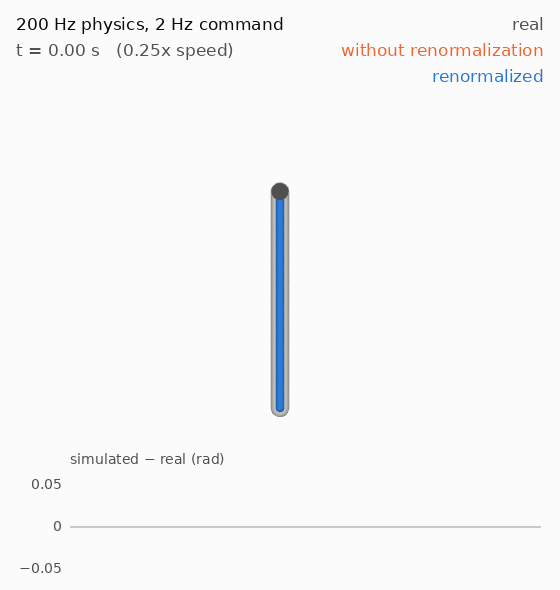
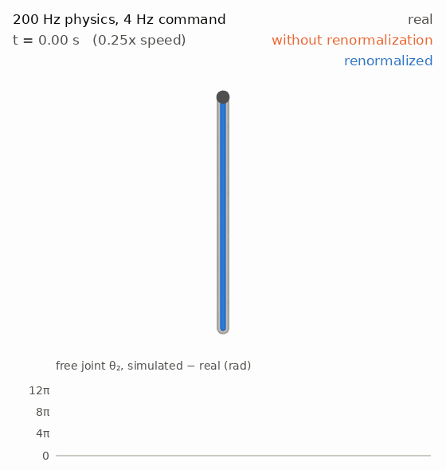
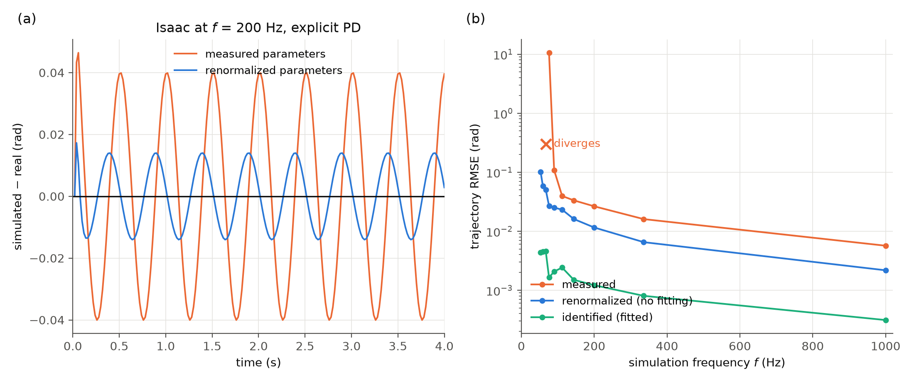
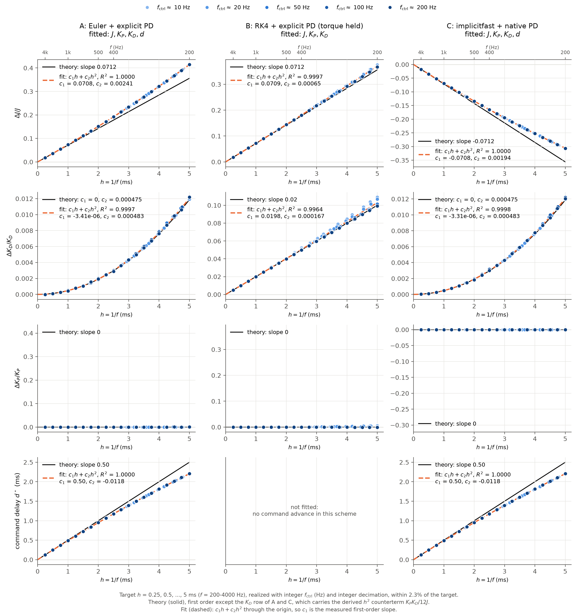

# R4R: Renormalization for Robotics

Experiments for *Effective Parameters, Real Behavior: Renormalization for Robotics — From Infinite Electron Mass to Sim-to-Real Gap*, by Youran Sun, Jiaxuan Guo, Xingyu Ren, Chugang Yi and Haizhao Yang.

[](https://arxiv.org/abs/2607.24079)
[](https://arxiv.org/pdf/2607.24079)
[](#citation)

The paper argues that simulator parameters should be treated as effective, resolution-dependent quantities $\theta^\star_{\mathrm{sim}}(a)$ rather than copies of measured values.
Its analytic example is PD control at a finite simulation frequency, where a small effective delay $\delta t \propto 1/f$ shifts the parameters that make the simulator reproduce the real motion:

$$
K_D^{\mathrm{sim}} = K_D^{\mathrm{real}} + \delta t \cdot K_P^{\mathrm{real}},
\qquad
J^{\mathrm{sim}} = J^{\mathrm{measured}} + \delta t \cdot K_D^{\mathrm{real}}.
$$

<p align="center">
  
  
</p>

Left, the pendulum on its 2 Hz command; right, the double pendulum on its 4 Hz command, with only the upper link driven; both at quarter speed. Grey is the real motion, drawn behind two 200 Hz simulators: without renormalization (orange), that is with the measured parameters as they are, and with the renormalized parameters (blue). Without renormalization the rod swings up to 0.05 rad off the real one and the free link is a radian off by 0.54 s; renormalized, the rod stays on it and the free link holds until 1.93 s.

## Experiment 1: PD-controlled pendulum at finite simulation frequency


**(a) The measured parameters are the wrong ones to use.** At the legged_gym default of 200 Hz physics, a simulator given the rod's measured inertia and the robot's actual gains swings up to 0.05 rad away from the real pendulum on the 2 Hz command. The paper's first-order prediction, which needs no real-world data at all, stays on it. Pooled over all five commands the RMSE goes from 2.64e−2 rad to 7.30e−4 rad, with one parameter set used for every command.

**(b) The same holds across simulation frequencies, and the measured parameters eventually fail outright.**

- The renormalized parameters give a **36× smaller** error at 200 Hz, with no fitting. Measured parameters only match it at $f$ = 7.2 kHz, so the same accuracy costs 36× fewer physics steps.
- Fitting on top of the formula gains only another 1.50× — and that is its in-sample error, three parameters against five 4-second trajectories — and the fitted parameters differ from the predicted ones by about 1% ($J^\star/J$ = 1.369 against 1.356 at 200 Hz). That residual is the second-order term in $h$, not an artifact of fitting: identifying on one command or on all five gives the same parameters to four digits.
- At 50 Hz the measured parameters diverge, while $J^\star = 2.42J$ keeps the same simulation stable and accurate to 1.10e−2 rad. Inflating the inertia both absorbs the omitted sub-step dynamics and raises the stability limit.

The panel shows 50–1000 Hz, the range a robot simulator actually runs at; the sweep itself goes to 5 kHz.

### Flow of the effective parameters


Identified parameters against the physics time step, for the three MuJoCo schemes, on a nearly uniform grid $h$ = 0.25 to 5 ms reached with integer control frequency and decimation. Shifts are shown as fractions of the measured value, so the scale is the same in any engine. Arms A and C identify a command delay as well; without it they cannot represent the half-step command advance of semi-implicit Euler.

Each panel that the theory predicts a flow for is fitted as $c_1 h + c_2 h^2$ through the origin, so the first-order slope $c_1$ can be read against the theory on its own. **Fitting a straight line instead is what makes the theory look wrong**: the raw linear slope of $\Delta J/J$ in arm A is 0.0834, 17% above prediction, purely because a curve is being measured with a ruler.

| | $c_1$ identified | $c_1$ predicted | error |
|---|---|---|---|
| A: $\Delta J/J$ | 0.0708 per ms | 0.0712 ($K_D/2J$) | −0.5% |
| B: $\Delta J/J$ | 0.0709 per ms | 0.0712 | −0.4% |
| C: $\Delta J/J$ | −0.0708 per ms | −0.0712 | −0.5% |
| B: $\Delta K_D/K_D$ | 0.0198 per ms | 0.0200 ($K_P/2K_D$) | −1% |
| A, C: command delay | 0.50 per ms | 0.50 ($h/2$) | −0.03% |
| A, C: $\Delta K_D/K_D$ | 1.8e−6 per ms | 0 | — |

The bare inertia is scheme-dependent — $J + hK_D/2$ for both explicit-PD schemes (Euler and RK4) but $J - hK_D/2$ for implicitfast — while the matched behaviour is the same, like counterterms under different regularization schemes.

**Second order.** Backward error analysis of the step map gives the continuous system each integrator is really solving. For semi-implicit Euler with an explicit PD torque (A) and for implicit damping (C), which is the same map with $J \to J + hK_D$:

$$J_e = J \mp \frac{h K_D}{2} - h^2 \frac{J K_P + K_D^2}{12 J}, \qquad K_{P,e} = K_P, \qquad K_{D,e} = K_D - h^2 \frac{K_P K_D}{12 J}$$

so the identified damping must curve upward as $\Delta K_D = + h^2 K_P K_D / 12 J$. The $K_D$ row of A and C draws that parabola: predicted $c_2$ = 4.75e−4 per ms², identified 4.82e−4, a 1.6% error with no fitted scale. Feeding these effective parameters to an exact integrator drops the error from $O(h^2)$ to $O(h^3)$, confirming the derivation.

What is left over at $O(h^2)$ after projecting onto the three tunable operators is $-c\left[\cos\theta \left(K_P(\theta - r) + c\sin\theta\right) + J\dot\theta^2\sin\theta\right] / 12 J^2$, proportional to the gravity torque $c = mgl/2$. **A linear plant stays exactly renormalizable at second order**; only the gravitational nonlinearity obstructs it.

**$K_P$ does not flow, and its row is where the obstruction lands.** The derivation gives $K_{P,e} = K_P$ exactly to second order, so the $K_P$ row is drawn unfitted, on the same scale its own scheme's $\Delta J/J$ uses, where it is a flat line. The scatter visible once that row is magnified is not a flow but the least-squares projection of the unrepresentable remainder, and it moves with the command rather than with $h$. Holding $h$ = 5 ms and changing only the command:

| | $\Delta J/J \div h^2$ | $\Delta K_D/K_D \div h^2$ | $\Delta K_P/K_P \div h^2$ |
|---|---|---|---|
| $f_\mathrm{ctrl} \times$ dec = 10×20 → 200×1 | 0.0166 throughout | 4.80e−4 → 4.66e−4 | +3.0e−6 → **−9.6e−6** |
| drive 0.5 → 8 Hz | 0.0166 throughout | 4.78e−4 → 4.79e−4 | −2.2e−6 → **+6.4e−7** |
| amplitude 0.05π → 1.0π | 0.0166 throughout | 4.78e−4 → 5.16e−4 | −1.5e−7 → **+4.9e−5** |
| fitting window 1 s → 4 s | 0.0166 throughout | 4.66e−4 → 4.81e−4 | −9.6e−6 → **+1.04e−5** |

$J$ and $K_D$ are counterterms: they are inside the span, so they do not care what the command is. $\Delta K_P$ changes sign four different ways, grows with amplitude as the gravitational obstruction should, and is three orders of magnitude smaller than $\Delta J/J$ anyway.

$K_P$ is nevertheless left free here, unlike in experiment 2, and that is a result rather than an oversight: **released, it comes back to zero on its own**, which is stronger evidence than pinning it there. Refitting the whole 200 Hz chain with $K_P$ held changes the first-order slopes in the fifth digit (A: 0.07084 against 0.07085, delay identical, post-fit error 0.1% worse) and only improves B's $\Delta K_D$ from 0.01996 to 0.02000. Experiment 2 has to hold it because there the unrepresentable remainder is 550× larger — 1.6e−4 rad against 2.9e−7 — and a redundant operator collinear with the rotor inertia has something to absorb.

### System

| Quantity | Value |
|---|---|
| Pendulum | uniform rod, hinge at one end, gravity on |
| Mass $m$ | 1 lb = 0.4536 kg |
| Length $l$ | 1 ft = 0.3048 m |
| Inertia about hinge $J = ml^2/3$ | 0.01405 kg m² |
| Max gravity torque $mgl/2$ | 0.678 N m |
| $K_P$, $K_D$ | 80 N m/rad, 2 N m s/rad (ANYmal-C in [legged_gym](https://github.com/leggedrobotics/legged_gym)) |

Derived scales: $\omega_n = \sqrt{K_P/J} = 75.5$ rad/s (12.0 Hz), damping ratio $\zeta = 0.94$.
The expansion parameter is $hK_D/J$, which equals 0.71 at the legged_gym default $f = 200$ Hz and reaches 1 at $f = 142$ Hz.

### Controller and command

Torque $\tau = K_P(\theta_{\mathrm{ref}} - \theta) - K_D\dot\theta$, as in legged_gym (zero target velocity).
The reference is $\theta_{\mathrm{ref}}(t) = A\sin(2\pi f_{\mathrm{drive}} t)$ at five drive frequencies, $f_{\mathrm{drive}}$ = 0.5, 1, 2, 4, 8 Hz, each for 4 s.
$A = \pi/2$ up to 2 Hz and falls as $1/f_{\mathrm{drive}}$ above it, so the peak command velocity stays at 19.7 rad/s, as a real joint would.
The amplitude is large, so gravity acts nonlinearly throughout.
A single parameter set must serve all five commands, so identification cannot specialize to one of them.
The control frequency is fixed at 50 Hz and only the decimation varies, so every resolution sees the same held command and the same real trajectory; $h = 1/(50 \times \text{decimation})$ runs from 20 ms down to 0.2 ms.

### Ground truth ("real")

On a real robot the actuator PD loop runs at kHz rates, so the real system is continuous-time PD under the held command:

$$
J\ddot\theta = -\frac{1}{2} m g l \sin\theta + K_P(\theta_{\mathrm{ref},k} - \theta) - K_D\dot\theta,
\qquad t \in [t_k, t_{k+1}).
$$

It is solved interval by interval with DOP853 at `rtol = atol = 1e-12`.

### Simulator

MuJoCo with the `RK4` integrator; the PD torque is computed in Python from the current state at the start of each physics step and held for the whole step.
Holding the torque delays both feedback terms by half a step on average, which is exactly the paper's model with $\delta t = h/2$, so the predictions are

$$
J^\star = J + \frac{h}{2} K_D, \qquad K_D^\star = K_D + \frac{h}{2} K_P, \qquad K_P^\star = K_P.
$$

`common.py` also implements MuJoCo's `Euler` (arm A) and `implicitfast` (arm C) schemes, which shift the bare parameters differently; the flow figure covers all three, the behaviour figure uses RK4.

### System identification

For each resolution, find the one $(J, K_P, K_D)$ minimizing the RMSE between the simulated and real $\theta$, pooled over all five commands, on the simulator's time grid.
Gravity breaks the overall scale symmetry $(J, K_P, K_D) \to \lambda(J, K_P, K_D)$, so all three are identifiable.

- `scipy.optimize.least_squares` on log-parameters, with the trajectory residual as the residual vector.
- Continuation from fine to coarse steps, plus restarts from the measured and predicted parameters.
- Diverged rollouts receive a large constant residual.

### Checks

- MuJoCo's hinge inertia and gravity torque match the analytic values to 10 digits, and a native PD actuator integrated with RK4 at 20 kHz reproduces the ground truth to $1.3\times10^{-12}$ rad (`sanity_check.py`).
- The effective parameters depend on the physics resolution alone, not on how the command was generated: identified on the 2 Hz command across five control frequencies from 10 to 200 Hz, they agree within 0.03% at $h$ = 1 ms and 0.2% at $h$ = 2.5 ms (`run_flow.py`).
- The step size at which measured parameters match the renormalized accuracy is measured, not extrapolated: the sweep runs measured parameters down to $h$ = 0.04 ms (25 kHz).

## Experiment 2: driven double pendulum, a chaotic system

The same driven link now carries a second, unactuated link. That link is hinged 40% along its own length, so its mass centre sits 3.05 cm from its hinge and gravity barely restores it — the arrangement of a chaotic-pendulum desk toy. It tumbles 14.5 times in 3 s, and a $10^{-9}$ rad perturbation of the initial state grows to $6\times10^{-5}$ rad over the same window (Lyapunov exponent 3.1 /s).

Here the paper's prediction is the multi-body one from its appendix, $\mathbf M^{\mathrm{sim}} = \mathbf M^{\mathrm{real}} + \delta t \cdot \mathbf K_D$: a constant added to the joint-space inertia, which in MuJoCo is exactly a rotor inertia (`armature`) on the driven joint. The physical joint has none; at 200 Hz the simulator needs 5.1e−3 kg m², which is 10% of the smallest joint-space inertia the configuration reaches.

### Flow of the effective parameters


The grid is experiment 1's: $h$ = 0.25, 0.5, ..., 5 ms, each step reached with an integer control frequency (50, 100, 200 Hz) and integer decimation. One parameter set is fitted to five drive frequencies at once, over 0.1 s, short enough that the trajectory error is still linear in the parameter error, with **both** joints in the residual, so the free link has to be reproduced too. The three columns are the same MuJoCo schemes as in experiment 1.

Only the counterterms the derivation predicts are fitted: a rotor inertia on the driven joint, $K_D$, and a command delay for the two schemes that hold the command. The passive joint gets none, because $\mathbf D = -\partial\mathbf F/\partial\dot{\mathbf q}$ has an identically zero second row — it carries no PD gains — so $\delta\mathbf M$ has nothing to put there.

| | measured $c_1$ | predicted | $R^2$ |
|---|---|---|---|
| A: Euler + explicit PD, rotor inertia$/M_{11}^{\min}$ | +0.0182 per ms | +0.0193 ($K_D/2$) | 0.9962 |
| B: RK4 + explicit PD, rotor inertia$/M_{11}^{\min}$ | +0.0193 per ms | +0.0193 | 1.0000 |
| C: implicitfast + native PD, rotor inertia$/M_{11}^{\min}$ | −0.0204 per ms | −0.0193 | 0.9954 |
| B: $\Delta K_D/K_D$ | +0.0200 per ms | +0.0200 | 1.0000 |
| A and C: command delay | +0.517 | +0.500 ($h/2$) | 0.9995 |

**All three schemes follow the prediction**, sign included: RK4 to four digits, the two first-order schemes to 6%, and the delay to 3%. The rotor inertia the simulator needs is not small — at 200 Hz it is 5.1e−3 kg m², 10% of the smallest joint-space inertia the configuration reaches.

**$K_P$ is held at its measured value, and that is what makes the rest work.** The derivation gives $K_P$ no counterterm at either order, but it is strongly collinear with the rotor inertia (correlation −0.93). Left free, least squares uses it to fake-absorb the part of the discretization error that *no* available operator can represent, and drags the rotor inertia off by up to 68% in the process. The giveaway is that it buys nothing: the post-fit error with $K_P$ free is 2.698e−4 rad against 2.699e−4 with it fixed. A redundant operator does not make the model better, it makes the coefficients meaningless — the usual reason an effective theory fixes its operator basis before fitting.

**What is left over is the genuinely unrepresentable part.** The second link contributes an off-diagonal inertia counterterm and the antisymmetric part of the Coriolis velocity Jacobian, neither of which MuJoCo can express: `armature` is diagonal and $\delta\mathbf M$ here is not symmetric. That remainder cannot vanish, and it does not — it shows up as the 6% bias in A's and C's first-order slope, as the $c_2$ terms, and as a post-fit error that stays finite (1.6e−4 rad at $h$ = 1 ms for A and C, 1.7e−5 for RK4). It does **not** show up as a parameter that refuses to flow. Non-renormalizable means the residual has a floor, not that the counterterms stop being right.

**A and C turn out to be the same fit in two coordinate systems.** Explicit damping makes the joint behave lighter by $h\mathbf K_D/2$ and implicit damping makes it behave heavier by the same amount, so with a rotor inertia $a$ on the joint the two schemes realize $\mathbf M + a - h\mathbf K_D/2$ and $\mathbf M + a + h\mathbf K_D/2$. They reach the same effective system whenever $a_A - a_C = hK_D$ — and the identified armatures satisfy that across the whole grid to 0.5%, while the two sweeps return the same command delay to nine digits and the same post-fit error to twelve.

The opposite signs in the figure are therefore **one counterterm read from two origins**, not two effects. Nothing that can be measured distinguishes the schemes here: the residual, the delay and $K_D$ are identical, and only the value of $a$ differs, by a known finite shift. That is a change of renormalization scheme, and it is why "which integrator is more accurate" is the wrong question for this system — if `armature` is free to tune, A and C are the same simulator. They differ only when it is pinned at the physical value, and then they differ by exactly $hK_D$.

### Behaviour


**(a) Chaos turns a parameter error into a lost trajectory.** At 200 Hz the measured-parameter simulation follows the real free link for about 1.7 s and then leaves it for good, ending 40 rad — six turns — away. The renormalized one stays within a few radians through 2.5 s.

**(b) The same error 11× faster, with no fitting.** What the measured parameters need 1000 Hz to reach, the renormalized ones reach at 89 Hz. Read vertically instead, the same two curves say 10× less error at the same rate. The saving is the number that gets paid for: the physics step is the inner loop of every RL rollout, and it is bought by a formula evaluated once. The horizon over which the free link is still followed to within half a turn goes from 1.92 s to 2.44 s at 200 Hz.

**The identified curve is scored out of sample**: it is fitted on 0.1 s across five drive frequencies, then measured on a single drive over ten times that window, exactly like the other two. On that footing **the formula with no data at all lands within a factor of 1.9 of the best fit** at every resolution from 150 Hz up — and at 50 Hz the fit is worse than doing nothing (1.56 rad against the measured parameters' 0.75), because 0.1 s at $h$ = 20 ms is five command steps and the minimum it finds does not survive the extrapolation. That factor of 1.9 is the second-order term in $h$, which the Lyapunov exponent amplifies: a chaotic observable is where one would expect to need the next order, and it costs less than a factor of two.

### System and method

Both rods are 1 lb and 1 ft, as in experiment 1. Joint 1 carries the same PD controller ($K_P$ = 80, $K_D$ = 2); joint 2 is free. The command is $(\pi/4)\sin(2\pi f_{\mathrm{drive}} t)$, sampled and held at the control rate. At $f_{\mathrm{drive}}$ = 4 Hz its 19.7 rad/s peak velocity matches experiment 1; the flow sweep fits one parameter set to 1, 2, 4, 8 and 16 Hz at once, to excite every direction.

The reference is the exact continuous-time motion under the held command, integrated with DOP853 at `rtol = atol = 1e-12`. Its right-hand side is MuJoCo's own rigid-body dynamics, so the reference and the simulator describe the same mechanism and differ only in time discretization; `sanity_check.py` confirms the joint-space inertia against the analytic value for two rods and checks that the reference is converged.

**The two windows are different on purpose.** Identification runs over 0.1 s: longer than the 80 ms the command needs to excite the parameters, shorter than the Lyapunov time $1/\lambda$ = 320 ms, beyond which chaos decorrelates the passive joint — with the measured parameters at $h$ = 5 ms its error passes 1 rad at 0.54 s and half a turn at 1.9 s, and matching it there says nothing about the parameters. Inside 0.1 s both joints are still in the regime where the trajectory error is linear in the parameter error, which holds to 1% out to 380 ms. The behaviour figure then scores every parameter set on the joint-angle RMSE over 1 s, ten times the fit window.

## Isaac Sim: the single pendulum in PhysX

Experiment 1 repeated in Isaac Sim 5.1 against the same reference solution, on the same $h$ grid, drawn by the same code (`figures.py`), so the two engines are directly comparable.

**PhysX has no RK4.** Its articulation solver offers only `TGS` and `PGS`, both first-order schemes with constraint iteration; a high-order explicit integrator does not fit a pipeline built around solving contacts and constraints each step. The three Isaac schemes therefore vary the solver and how the PD force is applied:

| | solver | PD force |
|---|---|---|
| explicit PD + TGS | TGS | torque computed in Python each physics step, as legged_gym does |
| PhysX drive + TGS | TGS | PhysX joint drive: an implicit spring, damping $K_D + \\delta K_P$ at $\\delta = h/32$ |
| PhysX drive + PGS | PGS | the same drive at $\\delta = h$ |

The model is validated first: the simulated error falls as $1/f$ towards the reference — 0.0284, 0.0149, 0.0038, 0.00095 rad at 200, 400, 1600, 6400 Hz — so Isaac and MuJoCo describe the same mechanism.

### Flow of the effective parameters


Four parameters are fitted: a rotor inertia on the joint (the physical joint has none, so this plays the role of $\Delta J$), $K_P$, $K_D$, and a command delay. Each scheme is given its own counterterms rather than MuJoCo's, because each realizes a different step map.

**What PhysX actually computes.** PhysX 5's CPU code is BSD-3 open source ([NVIDIA-Omniverse/PhysX](https://github.com/NVIDIA-Omniverse/PhysX)) and this experiment runs the CPU pipeline, so the solver can simply be read. `DyCpuGpuArticulation.h` forms, once per position iteration, with $a = \delta(\delta K_P + K_D)$ and $x = 1/(1 + a/J)$:

$$F \leftarrow F(1-x) - x a \dot\theta + K_P x \delta (r - \theta)$$

whose fixed point is

$$\tau = \frac{K_P (r - \theta) - (\delta K_P + K_D)\dot\theta}{1 + \delta(\delta K_P + K_D)/J}$$

**so the damping the joint feels is $K_D + \delta K_P$, not $K_D$.** PGS runs this at $\delta = h$. TGS advances time inside its position iterations, so there $\delta = h/N$ with $N$ = `solverPositionIterationCount`, 32 by default — **but gravity is not substepped with it**: `PxSceneFlag::eENABLE_EXTERNAL_FORCES_EVERY_ITERATION_TGS` is off by default, so `DyTGSDynamics.cpp` integrates external forces once over the whole step before the iterations start. Composing $N$ substeps of the drive alone would make $N$ cancel out of the $h^2$ terms; it does not, and that single fact is what the data insists on. Backward error analysis of the step as PhysX really builds it, gravity once over $h$ followed by $N$ drive substeps of $h/N$, gives

$$J^\star - J = -\frac{h K_D}{2N} + h^2\left[-\frac{K_P}{12} + \frac{K_P}{6N^2} + \frac{K_D^2}{12 J N^2}\right]$$

$$K_P^\star - K_P = h^2 \frac{K_P^2 (1 - N^2)}{12 J N^2}, \qquad K_D^\star - K_D = -\frac{h K_P}{N} + h^2 \frac{K_D K_P (2 - N^2)}{12 J N^2}$$

At $N = 1$ these reduce exactly to PGS, where the $h^2$ terms are $+(JK_P + K_D^2)/12J$, $0$ and $+K_P K_D / 12 J$. At large $N$ all three relative $h^2$ coefficients tend to the same value $-K_P/12J$ — a common factor on $J$, $K_P$ and $K_D$ is indistinguishable from a change in gravity, which is exactly the operator the un-substepped gravity leaves behind.

For the explicitly held torque there is nothing to read, so the step map was measured instead: put the simulator in a known state, take one step, subtract the known $h^1$ part and extrapolate $h \to 0$ (`exp1_pendulum/probe_step_map.py`, which identifies MuJoCo's three arms to 0.07%, and `isaac/probe_step_map_isaac.py`). The answer is $M_{2\theta} = f$ and $M_{2v} = 0$ whatever the iteration count: **semi-implicit Euler**, so MuJoCo's Euler counterterms apply unchanged.

Fitted as $c_1 h + c_2 h^2$ through the origin, on the same grid as MuJoCo:

| | identified $(c_1, c_2)$ | predicted $(c_1, c_2)$ | $R^2$ |
|---|---|---|---|
| explicit PD + TGS: rotor inertia$/J$ | (+0.0671, +2.9e−3) | (+0.0712, +2.2e−3) | 0.995 |
| explicit PD + TGS: command delay | (0.52, −0.016) | (0.50, 0) | 0.992 |
| **PhysX drive + PGS: rotor inertia$/J$** | **(−0.0712, +2.05e−3)** | (−0.0712, +2.16e−3) | 0.9998 |
| **PhysX drive + PGS: $\Delta K_D/K_D$** | **(−0.0402, +5.4e−4)** | (−0.0400, +4.7e−4) | 0.9998 |
| PhysX drive + PGS: $\Delta K_P/K_P$ | (+1e−5, −3e−6) | (0, 0) | — |
| PhysX drive + TGS: rotor inertia$/J$ | (−0.00257, −4.1e−4) | (−0.00222, −4.7e−4) | 0.951 |
| PhysX drive + TGS: $\Delta K_D/K_D$ | (−0.00152, −4.0e−4) | (−0.00125, −4.7e−4) | 0.978 |
| **PhysX drive + TGS: $\Delta K_P/K_P$** | **(−2e−5, −4.6e−4)** | (0, −4.7e−4) | 0.997 |

The PGS column matches to four digits. Under TGS the fit trades $c_1$ against $c_2$, so the fair comparison is the total shift at the coarsest step: at $h$ = 5 ms theory and experiment give −0.0229 against −0.0230 for the inertia, −0.0181 against −0.0177 for $K_D$, and −0.0119 against −0.0115 for $K_P$ — **within 3% on all three rows, including the one the theory says is zero at first order**.

Each map is checked numerically as well as symbolically: feeding its effective parameters to an exact integrator drops the error from $O(h)$ to $O(h^2)$ to $O(h^3)$. Under TGS with gravity on it stops at $O(h^2)$, and switching gravity off recovers the third order — the floor is the gravitational obstruction derived for MuJoCo, not a missing counterterm.

**The counterterm is a property of the discretization, not of the engine**, and the sign is a property of the scheme. An explicitly held torque gives $+hK_D/2$ in both engines; the implicit drive gives $-hK_D/2N$, the same flip MuJoCo shows for `implicitfast`. TGS is the same drive at a 32× smaller step, which is also why it is the most accurate scheme out of the box — its measured-parameter error at $h$ = 1 ms is 1.8e−4 rad, 31× below PGS.

**Only 50, 100 and 200 Hz are plotted.** The pendulum's settling time is $2J/K_D$ = 14 ms. At those rates the control period is comparable or shorter, so every sample carries information about the parameters; at 10 Hz the pendulum reaches the static equilibrium for each held command within the first 14 ms of a 100 ms period, most of the trajectory says nothing, and the fit scatters. The symptom is visible in the data: at 10 Hz the error with the *measured* parameters is six times smaller, because the trajectory barely depends on them.

### Behaviour



With the predicted parameters, and no fitting at all, the error at 200 Hz drops 22× and at 1 kHz 182×. Below 110 Hz the measured parameters diverge outright while the renormalized ones keep running — the same stability rescue MuJoCo showed.

The video, rendered with the MuJoCo renderer from Isaac's joint angles so both engines produce the same picture: [`exp1_pendulum/results/isaac_single.mp4`](exp1_pendulum/results/isaac_single.mp4).

## MuJoCo Warp: the same pendulum on the GPU

MuJoCo Warp is MuJoCo reimplemented in NVIDIA Warp, and it is the solver [Newton](https://github.com/newton-physics/newton) runs on. It is the same discretization reached through a different implementation: the same three integrators, written as GPU kernels instead of C.



Nothing about the experiment is restated for it. The model XML, the reference solution, the grid, the starting points, the fitter and the drawing all come from the MuJoCo code; `mjwarp/pendulum_mjwarp.py` supplies a simulator with the same rollout signature, and `plot_flow.py --engine mjwarp` draws it with the same script. B is fitted with three parameters here too.

| | MuJoCo C | MuJoCo Warp |
|---|---|---|
| A: $\Delta J/J$ | $c_1$ +0.07082, $c_2$ +0.002409 | +0.07081, +0.002411 |
| A: command delay | $c_1$ +0.49984, $c_2$ −0.01176 | +0.49988, −0.01177 |
| B: $\Delta J/J$ | $c_1$ +0.07088, $c_2$ +6.502e−4 | +0.07088, +6.503e−4 |
| B: $\Delta K_D/K_D$ | $c_1$ +0.01977, $c_2$ +1.674e−4 | +0.01978, +1.671e−4 |
| C: $\Delta J/J$ | $c_1$ −0.07084, $c_2$ +0.00194 | −0.07085, +0.001941 |
| C: $\Delta K_D/K_D$ | $c_1$ 0, $c_2$ +4.82e−4 | 0, +4.833e−4 |

**Every flow agrees to four digits**, and the trajectories themselves agree step for step to 1.2e−7, which is float32 round-off. One runs C on a CPU, the other runs Warp kernels on a GPU, and the renormalization group flow is the same: the counterterm belongs to the discretization, not to the code that implements it.

Read the other way round, this is a check on MuJoCo Warp. Rather than comparing implementations line by line, each is measured by the same physical procedure — identify the effective parameters of a PD-controlled pendulum across three integrators, five control rates and twenty time steps — and the two measurements agree to four digits on six independent flows. A rewrite that had drifted anywhere in the integration, the actuator or the command handling would show up as a different counterterm.

**It is far slower here, and that is expected.** A step costs 2.7 µs in MuJoCo C against 277 µs in MuJoCo Warp, because a step launches 93 GPU kernels (334 under RK4, which evaluates the force four times) and each launch costs about 3 µs regardless of how little work it carries. A kernel is one stage of the physics pipeline, not one environment: its count is fixed by the algorithm, and stepping 64 worlds costs the same as stepping 8. MuJoCo Warp is built for thousands of environments at once, where that 3 µs is amortized away; a 1-DOF pendulum in 8 worlds is pure launch overhead. Disabling the stages this model does not use — contacts, constraints, sensors — removes 24% of the kernels and 6% of the time, so the rest is the core rigid-body pipeline.

Three things make the sweep practical anyway, and none of them changes the answer:

- **CUDA graph capture**, which replays a hundred captured steps instead of relaunching them: 16× (`pendulum_mjwarp.py`).
- **Advancing every starting point at once** so one batched rollout serves them all, since 64 worlds cost what 8 do: 5×. This is in the shared fitter, so both engines use the same optimizer, the same tolerances and the same iterates — verified to give MuJoCo's parameters to nine digits.
- **Starting from the MuJoCo answer** for the same grid point. The minimum is already known to float32 precision, so the fit only has to confirm it: 1.6×, and the converged values are unchanged. The fit is still an independent one, since it converges on MuJoCo Warp's own trajectories.

## Reproduce

```bash
uv sync
cd exp1_pendulum
uv run python sanity_check.py     # MuJoCo model vs ground-truth ODE
uv run python run_gap.py          # error of each parameter set across resolutions
uv run python plot_pendulum.py    # the figure
uv run python run_flow.py         # effective parameters on a uniform grid of time steps
uv run python run_flow.py --delay # same, also identifying the command delay
uv run python plot_flow.py        # flow figure
uv run python video.py            # pendulum video (needs EGL)
uv run python derive_second_order.py   # every step map's counterterms, symbolic then numeric
uv run python probe_step_map.py        # which step map each arm realizes, measured

cd ../exp2_double_pendulum
uv run python sanity_check.py     # inertia, reference convergence, chaos
uv run python run_flow.py         # effective parameters on a uniform grid of time steps
uv run python run_flow.py --delay # same, also identifying the command delay (arms A and C)
uv run python plot_flow.py        # flow figure
uv run python run_gap.py          # error of each parameter set across resolutions
uv run python plot_pendulum.py    # behaviour figure
uv run python video.py            # three pendulums overlaid (needs EGL)
```

Isaac Sim runs in its own Python 3.11 environment (`isaacsim[all]==5.1.0.0`), with `mujoco`
installed alongside so that it can call the same reference solution. Its figures are drawn by
the same `figures.py` as the MuJoCo ones, so the two cannot drift apart.

```bash
cd isaac
# flow: the same (f_ctrl, decimation) grid and one 2 Hz command as exp1/run_flow.py.
# Five control rates x h = 0.5 to 5 ms, about 6 h per arm; --resume fills gaps only.
$ISAAC_VENV/bin/python run_single.py --arm A           # also --arm B, C
$ISAAC_VENV/bin/python dump_traj.py single
# which step map does each scheme realize, and how does it depend on the iteration count
$ISAAC_VENV/bin/python probe_step_map_isaac.py A 1 4 32
$ISAAC_VENV/bin/python probe_drive_law.py B
uv run python plot_isaac_flow.py        # figures, in the project venv
uv run python plot_isaac_behaviour.py
uv run python video_isaac.py --exp single
```

```bash
cd ../mjwarp
./launch.sh                             # the whole sweep, seeded from the MuJoCo answer
cd ../exp1_pendulum
uv run python plot_flow.py --engine mjwarp
```

`double_isaac.py` and `run_double.py` hold a validated Isaac model of the chaotic double
pendulum. It is not swept: experiment 1 already shows the counterterms carry across engines,
and experiment 2's point is the passive joint, which is the same mechanism in either.

## Roadmap

Each step is one commit, reviewed before the next begins.

- [x] Plan
- [x] Experiment 1, MuJoCo: flow, gap, and the pendulum video
- [x] Experiment 2, MuJoCo: the chaotic double pendulum
- [x] Isaac, experiment 1: the single pendulum in PhysX
- [x] MuJoCo Warp, experiment 1: the same pendulum on the GPU

Three engines across two experiments is enough to make the point: the counterterms belong to
the discretization, not to the engine, and the second experiment's lesson — the passive joint,
and the operators that have to be left out of the fit — is the same mechanism whichever engine
steps it. The remaining engine/experiment pairs would repeat an answer already measured.

## Citation

```bibtex
@misc{sun2026effective,
      title={Effective Parameters, Real Behavior: Renormalization for Robotics - From Infinite Electron Mass to Sim-to-Real Gap},
      author={Youran Sun and Jiaxuan Guo and Xingyu Ren and Chugang Yi and Haizhao Yang},
      year={2026},
      eprint={2607.24079},
      archivePrefix={arXiv},
      url={https://arxiv.org/abs/2607.24079},
}
```
